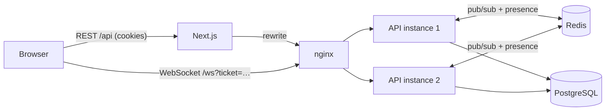

# Convo

Realtime team chat: workspaces, public and private channels, live messaging, file sharing, @mentions with
notifications, presence, typing indicators, read receipts and unread counts, built on raw WebSockets and Redis pub/sub so it scales past one server.

**Stack:** TypeScript · Next.js 16 · React 19 · Node.js · Express 5 · `ws` · Redis · PostgreSQL · Prisma 7 · Zod ·
TanStack Query · Tailwind CSS 4 · Vitest · Playwright · Docker · GitHub Actions

## Features

- **Auth:** email + password, httpOnly cookies, rotating refresh tokens with reuse detection.
- **Workspaces:** create, join with an invite code, rotate the code; owner / admin / member roles.
- **Channels:** public and private; private channels stay invisible (404, not 403) to non-members, and their
  names are never broadcast to the whole workspace.
- **Live messaging:** send over the socket with an ack, optimistic rows with retry, live edits and deletions.
- **Files:** attach up to 5 files (10 MB each) by picking, dragging or pasting. Images show inline, other
  files as download cards.
- **@mentions and notifications:** autocomplete while typing `@`, highlighted mentions, a bell with an unread
  count that updates live in every tab and clears once the channel is read past the mention.
- **Presence:** online/offline per workspace, correct with several tabs and several servers.
- **Typing indicators:** throttled on both client and server, expire on their own.
- **Read receipts and unread counts:** a per-member read pointer that only moves forward; "Seen by …" under
  the last message, unread badges in the sidebar, a "New messages" divider.
- **History and search:** keyset pagination while scrolling up (scroll position kept), case-insensitive
  search limited to channels the user can see.
- **Resilience:** reconnect with exponential backoff and jitter, re-subscribe after reconnect, refetch what
  was missed, application-level ping to detect half-open connections.

## Architecture



**Every event goes through the bus, even on a single server.** REST handlers and socket handlers call the same
services (`messages.service.ts`), which write to PostgreSQL and then `publish(topic, event)`. Each API instance
subscribes on Redis only to topics that one of its own sockets needs, and forwards events to those sockets.
With one instance or ten, the code path is the same.

**Topics**

| Topic       | Who listens                                           | Events                                                    |
| ----------- | ----------------------------------------------------- | --------------------------------------------------------- |
| `ws:<id>`   | sockets subscribed to the workspace                   | presence, public channel changes, members joining/leaving |
| `ch:<id>`   | channel members, plus people viewing a public channel | messages, edits, deletions, typing, read receipts         |
| `user:<id>` | every socket of that user                             | access granted/revoked, private channel announcements     |

When a user is added to a private channel, the API publishes `channel.access` on their user topic. Whichever
instance holds their sockets subscribes them to the channel topic right away, without a reconnect. Removing
someone from a workspace unsubscribes them the same way.

**Authenticating the socket.** The browser asks the REST API (same origin, cookie auth) for a ticket: a JWT valid
for 60 seconds with `aud: "ws"`. It opens `/ws?ticket=…`. Each ticket opens one socket only: its `jti` is marked
used on the first upgrade, so a ticket leaked through a proxy log cannot be replayed. Tickets and access tokens cannot be swapped for each
other, the `Origin` header is checked on upgrade, frames are limited to 16 KB and rate limited per socket.

**Presence across servers.** Each user has a Redis sorted set of connection ids, scored by expiry time and
refreshed by the 30-second heartbeat. "Online" means at least one unexpired entry. If an instance crashes, its
entries expire after 90 seconds instead of leaving people online forever.

**Read pointers** store the `createdAt` of the last read message, not the wall-clock read time, so comparisons
with messages are exact. The update runs `WHERE lastReadAt < :messageCreatedAt`, so two tabs can never move it
backwards. Unread counts are one SQL query over all channels.

**File uploads.** The browser uploads each file before sending the message, as the raw request body with
`Content-Type: application/octet-stream` (`POST /api/channels/:id/attachments?name=…`). That type is not one a
plain HTML form can send, so the CSRF guard used for JSON writes covers uploads too. The file streams to disk
with a byte limit, and the message then links the uploads by id: only the uploader's own, unsent uploads in
that channel. Image types are trusted only when the first bytes match (an HTML file renamed to `.png` becomes
a plain download), only PNG/JPEG/GIF/WebP render inline, and every file response carries
`Content-Security-Policy: sandbox`. Downloads check channel access on every request. An hourly sweep deletes
uploads never sent and files whose rows were removed by cascades. Storage sits behind a four-method interface;
the Docker setup shares one volume between both API instances.

**Mentions** are stored in the text as `<@userId>`, so renaming someone never breaks old messages. The server
only notifies people who can see the channel, a unique `(user, message)` index stops an edit from notifying
anyone twice, and notifications go to the user's own topic, so every tab and every server sees them.

### Protocol

All frames are JSON with a `type`. Client frames are validated with the Zod schema shared with the web app
(`packages/shared/src/protocol.ts`).

| Client → server                                              | Server → client                                              |
| ------------------------------------------------------------ | ------------------------------------------------------------ |
| `workspace.subscribe {workspaceId}`                          | `hello`, `presence.snapshot`, `presence`                     |
| `channel.focus {channelId \| null}`                          | `message.created` / `.updated` / `.deleted`                  |
| `message.send {channelId, content, attachmentIds, clientId}` | `message.ack {clientId, message}`, `error {code, clientId?}` |
| `typing {channelId}`                                         | `typing {channelId, user}`                                   |
| `read {channelId, messageId}`                                | `read {channelId, userId, messageId, at}`                    |
| `ping`                                                       | `pong`, `channel.*`, `workspace.member.*`                    |
|                                                              | `notification.created`, `notification.read {ids}`            |

## Running locally

Requirements: Node.js 22+. No Docker needed: `db:start` runs a real PostgreSQL from npm (`embedded-postgres`).
Without `REDIS_URL` the API uses an in-memory bus and presence store, which is fine for one instance.

```bash
npm install
cp apps/api/.env.example apps/api/.env      # then set the two JWT secrets
cp apps/web/.env.example apps/web/.env.local

npm run db:start      # terminal 1: PostgreSQL on :5434
npm run db:migrate    # create tables
npm run db:seed       # demo workspace: demo@whoischat.dev / demo1234
npm run dev           # terminal 2: web on :3200, API on :4200
```

Open http://localhost:3200 and press **Try the demo account**. To see realtime working, sign in as
`ayse@convo.dev` (same password) in a private window and chat between the two.

### With Docker

```bash
docker compose up --build    # http://localhost:3200
```

This starts PostgreSQL, Redis, **two API instances** and an nginx load balancer in front of them. Two browsers
can land on different instances and still chat live.

## Tests

```bash
npm test          # API: REST + realtime integration tests against a real database
npm run e2e       # Playwright: two browsers chatting
npm run lint && npm run typecheck
```

- `attachments.test.ts`: upload and download permissions, verified image types, the sandbox header, refusing
  form and text bodies, the size limit, attaching each upload once, cleanup on delete and the upload sweep.
- `notifications.test.ts`: who gets notified (not the author, not outsiders, not private-channel strangers),
  edits notifying once, marking read, clearing on channel read, and live delivery to every tab.
- `auth.test.ts`: register and login, identical errors for wrong password and unknown email, refresh token
  rotation, reuse detection revoking the whole family, two concurrent refreshes, logout and the CSRF guard.
- `workspaces.test.ts`, `channels.test.ts`: permissions, private channel visibility, pagination without gaps,
  unread counts, read pointers that never move back, search treating `%` and `_` literally.
- `realtime.test.ts` starts **two gateway instances** in one process and connects real WebSocket clients to
  each. It checks cross-instance delivery, acks and errors, typing throttling, read receipts, presence across
  tabs, access granted live, and that removed members stop receiving events. It also covers refused upgrades
  (missing ticket, forged ticket, reused ticket, foreign origin).
- `redis.test.ts` runs the Redis bus and presence store against a real Redis (in CI).
- `e2e/chat.spec.ts`: two users in separate browser contexts create and join a workspace and check presence,
  typing, delivery, "Seen by", unread badges, live edits, search and going offline.

CI runs all of it on every push with PostgreSQL and Redis service containers, then builds both Docker images.

## Project layout

```
apps/api      Express REST API + WebSocket gateway (src/realtime), Prisma schema and migrations
apps/web      Next.js app (src/lib/realtime.ts is the reconnecting socket client)
packages/shared  Zod schemas, API types and the WebSocket protocol, used by both apps
```

## Known limitations

- **Without Redis there is one instance.** The in-memory bus and presence only reach sockets in the same process, so running several API instances needs `REDIS_URL`.
- **Access tokens live until they expire.** Logout revokes the refresh token right away, but an already issued access token stays valid for up to 15 minutes.
- **Deletes are permanent.** Deleted messages are removed from the database, with no undo or audit trail.
- **Plain text only.** Messages are shown as text with line breaks; there is no Markdown or link preview yet.
- **Files live on local disk.** Several servers need a shared volume; there is no S3 backend or image thumbnails yet.
- **Mention autocomplete matches the first word.** Typing a space closes the list, so pick a name before typing a surname.

## Roadmap

- S3-compatible storage with signed URLs, and image thumbnails
- Message threads and reactions
- Turkish UI
- Full-text search with PostgreSQL `tsvector`
- Markdown formatting and link previews

## License

MIT
